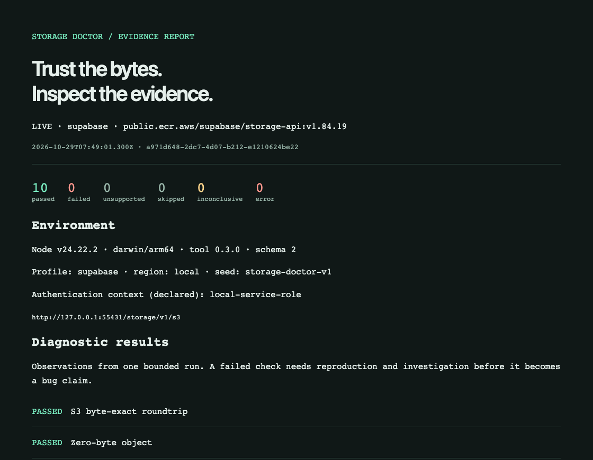
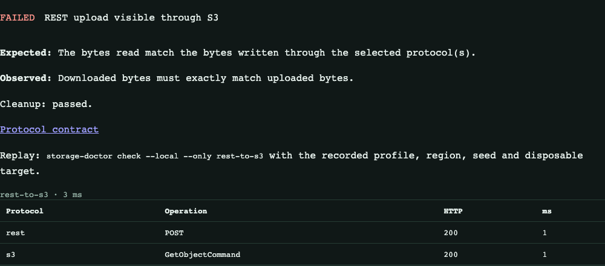
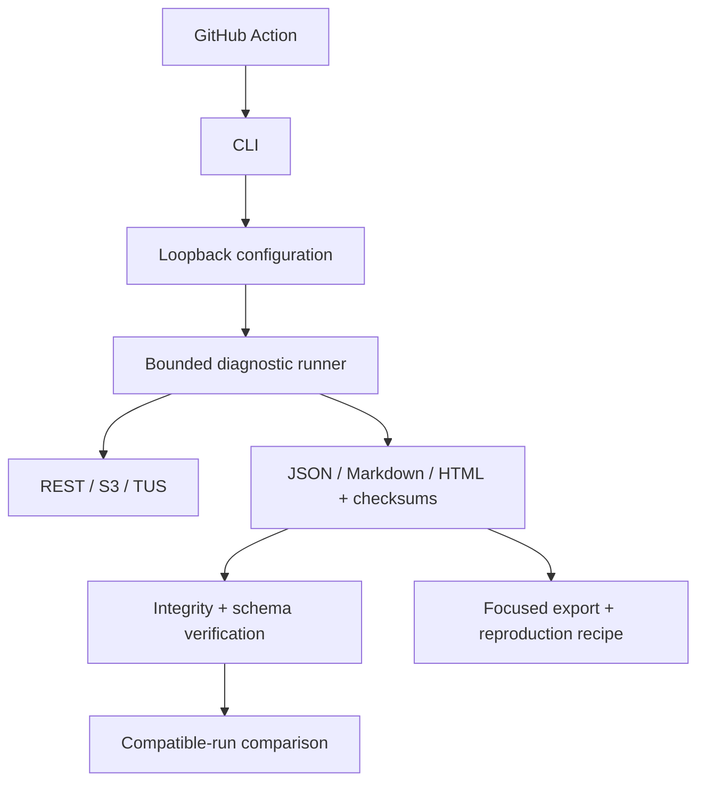

# Storage Doctor

**Detect storage regressions. Verify the evidence. Reproduce the failure.**

A local-first diagnostic CLI for developers investigating **Supabase REST, S3 and TUS**. Run ten bounded checks, compare compatible runs and keep evidence another engineer can inspect.

[](https://github.com/phlppgdfry/storage-doctor/releases/tag/v0.3.0) [](https://github.com/phlppgdfry/storage-doctor/actions/workflows/verify.yml) [](https://github.com/phlppgdfry/storage-doctor/actions/runs/41170073817) [](LICENSE)

[Try it safely](#try-it-safely) · [See a regression](#see-a-regression-and-reproduce-it) · [Validation](#verified-release-evidence) · [Architecture](#architecture) · [Review packet](docs/review.md)

[](examples/v0.3.0-rc2/report.md)

_Actual local Supabase run recorded on 2026-10-29. Ten passing checks describe this run, not universal compatibility. [Screenshot provenance and accessible text](examples/showcase/README.md)._

## Why it exists

An upload can succeed through one interface while a read, overwrite or deletion through another disagrees. An HTTP success alone does not prove that the bytes or visible state are correct. Storage Doctor records expected versus observed behavior, request operations and cleanup outcomes so you can investigate a local change with inspectable evidence.

1. **Run** fixed byte-integrity and state-visibility checks on a disposable loopback target—or try the credential-free fixture.
2. **Compare** a healthy baseline with a compatible candidate. Missing assurance and invalid evidence cannot become a green result.
3. **Investigate** changed checks, export a focused reproduction recipe and verify the bundle before sharing it. A regression classification is not proof of root cause.

Independent and developed with AI assistance. No cloud targets, telemetry or AI key. **v0.3.0 is released and in maintenance mode.** [Scope and alternatives](docs/product-validation.md) · [Engineering case study](docs/launch.md#case-study-when-the-test-was-wrong).

## Try it safely

From the release source, with **Node 22 or 24**:

```sh
git clone --branch v0.3.0 https://github.com/phlppgdfry/storage-doctor.git
cd storage-doctor
npm ci
node src/cli.js demo
```

Open the printed `report.html` path. This starts a temporary loopback **protocol fixture**, uses synthetic credentials and stops it afterward. It needs no Docker or storage account. **It does not test Supabase or establish vendor compatibility.**

After installing a reviewed tarball in a separate directory, use `node_modules/.bin/storage-doctor demo`. Do not assume `npx storage-doctor` belongs to this project. [Installation validation](docs/validation.md).

## See a regression and reproduce it

Use fresh output directories. The second and third commands below **intentionally exit 1**:

```sh
node src/cli.js demo --out reports/good
node src/cli.js demo --inject-corruption --out reports/bad
node src/cli.js compare --baseline reports/good/report.json --report reports/bad/report.json
node src/cli.js export rest-to-s3 --report reports/bad/report.json --out reports/reproduction
node src/cli.js verify --report reports/reproduction
```

The same validated engine generates both fixture runs. Comparison verifies the complete checksum bundles before classifying PASS→FAIL. Export retains expected/observed behavior, traces, seed and a reproduction recipe. Repeat the first three commands with new directories to reproduce the injected failure. A fixture disagreement is not a newly discovered storage defect.

**Baseline → injected failure → verified evidence.** The [captured baseline](examples/showcase/fixture-baseline/report.md) passed 10/10 checks; the [intentionally corrupted fixture](examples/showcase/fixture-candidate/report.md) failed nine. The [actual comparison output](examples/showcase/comparison.txt) classifies nine PASS→FAIL transitions and exits 1. Both bundles remain available for offline verification.



_Intentional fixture corruption, not a vendor defect. The screenshot's generic `check --local` replay line needs a separately provisioned target; reproduce this fixture with the `demo --inject-corruption` command above. [Capture provenance and exact commands](examples/showcase/README.md)._

For the existing ~45-second genuine terminal recording: [capture](examples/showcase/regression.cast) · [text transcript](examples/showcase/transcript.txt) · [metadata](examples/showcase/recording.json). Run `npm run demo:record` to create a fresh recording and original evidence; command output is captured, not invented.

## Compare two real local runs

Use the [real local integration recipe](docs/configuration.md#compare-two-real-local-runs) for Docker, Supabase CLI 2.122.0 and two independently retained runs. It provisions a unique private bucket, obtains local credentials in memory and removes only its owned resources. This is separate from the fixture demo above.

For your own disposable target, start with [the environment example](examples/local.env.example), provision a dedicated `sd-*` or `storage-doctor-*` bucket, then run:

```sh
node --env-file=.env src/cli.js doctor
node --env-file=.env src/cli.js check --local --pack core
```

`doctor` is a non-network configuration check. Credentials must permit the selected reads, writes and exact object deletes. Set `SD_AUTH_CONTEXT` to a non-secret policy/role label before recording live baselines; change the label whenever effective permissions change. The label is user-declared, **not an authorization attestation**. [Configuration and troubleshooting](docs/configuration.md).

## Read the evidence

[Real Supabase snapshot](examples/v0.3.0-rc2/report.md) · [Exact verification evidence](docs/validation.md) · [Report and comparison contracts](docs/report-format.md)

| Diagnostic status | Meaning                                                                          |
| ----------------- | -------------------------------------------------------------------------------- |
| PASS              | Executed assertions passed in this run                                           |
| FAIL              | Contract disagreement; investigate setup and semantics before blaming the target |
| INCONCLUSIVE      | Availability, authorization, timeout or budget prevented a conclusion            |
| UNSUPPORTED       | Selected profile excludes required protocols                                     |
| SKIPPED / ERROR   | Incomplete evaluation / harness error                                            |

Comparison requires a healthy baseline, the same diagnostic source/version, mode, scenario set, payload, seed, profile, region, timeout, budgets and declared auth context. Target versions may differ and are reported. Scenario order, durations, endpoint and bucket identities do not drive regression classification.

| Comparison exit | Meaning                                                                                   |
| --------------- | ----------------------------------------------------------------------------------------- |
| **0**           | Valid comparable checks remain passing                                                    |
| **1**           | Previously passing checks now fail; no root cause is established                          |
| **2**           | Lost assurance, invalid/incomparable evidence, unsuitable baseline or cleanup uncertainty |

FAIL→PASS is not accepted as a healthy-baseline comparison. Fixture/live, missing scenarios, unknown schemas, missing manifests and checksum mismatches cannot return a successful comparison. An attacker who rewrites both evidence and its manifest can forge integrity: **checksums do not prove authenticity**.

Each run writes validated JSON, Markdown, standalone HTML and SHA-256 checksums. HTML needs no JavaScript or external assets. New output directories are required; existing evidence is not overwritten. `--json` emits one JSON value; `--quiet` suppresses successful output. Other commands: `list`, `report`, `export`, `verify` and the fixed heuristic `plan`. See `--help`.

## Integrate into CI

The composite [GitHub Action](https://github.com/phlppgdfry/storage-doctor/blob/v0.3.0/action.yml) expects an already provisioned disposable loopback target and `SD_*` credentials. It runs checks, optionally compares a trusted baseline, writes a concise job summary and uploads evidence. It does not provision storage or authorize remote targets.

Use the [separate-consumer workflow](examples/consumer-workflow.yml) with an **actual reviewed 40-character commit SHA** from the released tag. The v0.3.0 Action includes the baseline and summary additions. Pin a reviewed commit in your workflow, and set `artifact-name` to a unique value for matrix jobs or repeated calls. The four-case [hosted consumer workflow](https://github.com/phlppgdfry/storage-doctor/blob/v0.3.0/.github/workflows/consumer.yml) checks actual success/failure/setup behavior and artifact upload/download/verification. See [validation](docs/validation.md).

A step in an existing job with Node 22/24 and a provisioned disposable target:

```yaml
- uses: phlppgdfry/storage-doctor@d8be992eff8ae64c3514bdeac43a8735ed09266b # v0.3.0
  with:
    pack: core
    artifact-name: storage-doctor-core
  # Supply SD_* credentials via the job environment; never paste them here.
```

## Architecture



The Action invokes the same CLI. The runner uses direct HTTP/S for REST/TUS and AWS SDK signing for S3. Reports are local files; comparison is offline. There is no daemon, hosted collector or model provider. [Module boundaries and protocol contracts](docs/architecture.md).

## Verified release evidence

| Evidence on the exact v0.3.0 release commit                                                                | Recorded result                                                                                                   |
| ---------------------------------------------------------------------------------------------------------- | ----------------------------------------------------------------------------------------------------------------- |
| [Node 22 / 24 CI](https://github.com/phlppgdfry/storage-doctor/actions/runs/41145223787)                   | 33 tests per version; formatting, syntax, docs, package and local Action smoke                                    |
| [Real disposable Supabase + Action](https://github.com/phlppgdfry/storage-doctor/actions/runs/41168269115) | 10/10 diagnostics; Action core 3/3                                                                                |
| [Hosted Action consumer](https://github.com/phlppgdfry/storage-doctor/actions/runs/41145223764)            | Four synthetic cases: success, corruption, invalid pack, missing credentials; artifact retrieval and verification |
| [Release assets](https://github.com/phlppgdfry/storage-doctor/releases/tag/v0.3.0)                         | Package, permanent evidence ZIP, checksums and exact-commit `VALIDATION.json`                                     |

These are recorded executions, not third-party certification. Independent human usability and security review remain unperformed. [Full validation history, including failures and fixes](docs/validation.md) · [Review tasks](docs/review.md).

## Limits and safety

- Only literal `127.0.0.1` / `[::1]` endpoints. Direct sockets bypass ambient proxies, refuse redirects and retain TLS validation. A loopback tunnel to production is still production; do not use one.
- UUID-owned object keys; sequential execution; 80 exploration requests, 120-second campaign, 8 MiB request/response limits and a separate 30-second aggregate cleanup allowance. Cancellation permits cleanup; process death or an unreachable target can leave disposable resources.
- Packs: `core`, `s3`, `cross-protocol`, `tus`, `all`. `SD_PROFILE=s3` excludes REST/TUS; it is not provider capability discovery. [Scenario contracts](docs/architecture.md).
- TUS checks offsets and continuation with a 6 MiB first chunk, not broken sockets, restart or crash recovery. Metadata coverage is S3 HEAD, not universal metadata mapping.
- Verified locally on macOS/arm64; hosted workflows target Linux. Windows execution remains unverified.
- Matching declared inputs does not establish identical permissions, dependencies, topology or configuration. No production/RLS certification, universal S3 compliance, benchmark, upstream endorsement or market validation is claimed.
- AI, automatic shrinking, adaptive research and additional providers remain deferred. `plan` is a fixed retest heuristic, not self-improvement.

## Documentation

| Task                                       | Start here                                                                                                                                                                                                                                      |
| ------------------------------------------ | ----------------------------------------------------------------------------------------------------------------------------------------------------------------------------------------------------------------------------------------------- |
| Install a reviewed release package         | [Independent installation and review](docs/review.md#install-and-execute-the-package)                                                                                                                                                           |
| Configure or troubleshoot a local target   | [Configuration and permissions](docs/configuration.md)                                                                                                                                                                                          |
| Interpret statuses, schemas and comparison | [Report contracts](docs/report-format.md)                                                                                                                                                                                                       |
| Understand design decisions                | [Architecture](docs/architecture.md) · [Case study and tradeoffs](docs/launch.md#case-study-when-the-test-was-wrong)                                                                                                                            |
| Contribute a focused fix                   | [Contributing](CONTRIBUTING.md) · [Security/private reporting](SECURITY.md)                                                                                                                                                                     |
| Inspect release and maintenance policy     | [Release process](docs/release.md) · [Current state](https://github.com/phlppgdfry/storage-doctor/blob/main/CURRENT_STATE.md) · [Changelog](https://github.com/phlppgdfry/storage-doctor/blob/v0.3.0/CHANGELOG.md) · [Roadmap](docs/roadmap.md) |

[MIT licensed](LICENSE). No npm registry package is published by this project; do not assume `npx storage-doctor` refers to it.
